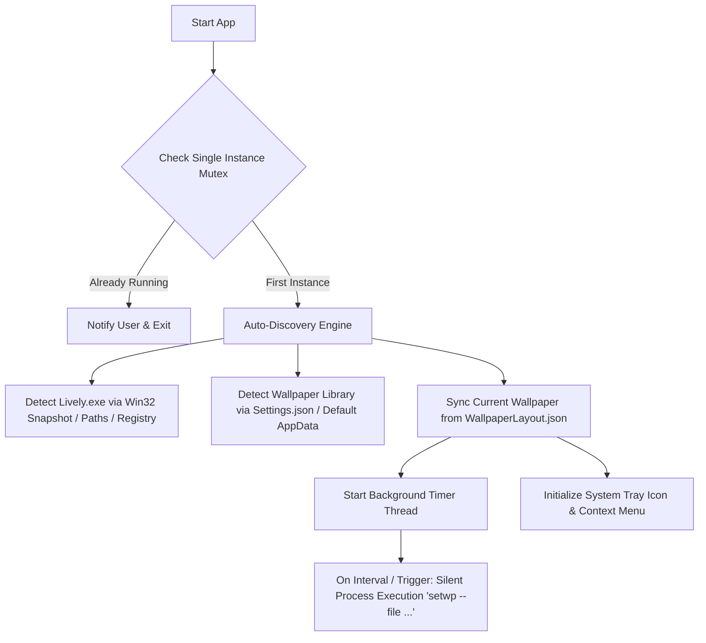

# Lively Wallpaper Shuffler

<p align="center">
  
</p>

<p align="center">
  <strong>A lightweight, zero-configuration Windows background companion for <a href="https://github.com/rocksdanister/lively">Lively Wallpaper</a> (v2.x+).</strong>
  <br>
  Automatically cycles and shuffles wallpapers with modern process execution and system-tray controls.
</p>

<p align="center">
  <a href="https://github.com/y0sh1da-available/Lively-Shuffler/releases"></a>
  
  
  
  
  <a href="LICENSE"></a>
</p>

---

## 📖 Table of Contents
- [Why This Utility?](#-why-this-utility)
- [Setup Tutorial (End Users)](#-setup-tutorial-end-users)
- [System Tray Controls](#-system-tray-controls)
- [Command Line & Hotkey Actions](#-command-line--hotkey-actions)
- [How It Works (Architecture)](#-how-it-works-architecture)
- [Developer Guide (Building from Source)](#-developer-guide-building-from-source)
- [License & Ownership](#-license--ownership)

---

## 💡 Why This Utility?

Older community shufflers (like *lively-wallpaper-playlist*) rely on an obsolete IPC TCP socket (`port 65432`) and hardcoded directory paths that are **broken** on modern Lively v2.x+ installations.

**Lively Wallpaper Shuffler** solves this natively:
- **Direct Process Execution:** Modern Lively Wallpaper accepts commands directly:
  ```cmd
  "<Lively_Directory>\Lively.exe" setwp --file "<Wallpaper_Folder_Path>"
  ```
- **Zero Configuration:** Dynamically finds your Lively installation and wallpapers directory without manual setup.
- **Silent Background Operation:** Commands run completely invisibly (`CREATE_NO_WINDOW`) so no command prompt windows flash on screen.
- **Self-Contained Executable:** No Python runtime, installers, or dependencies needed. Single `.exe` download.

---

## 🚀 Setup Tutorial (End Users)

Follow these simple steps to start shuffling wallpapers in under 30 seconds:

### Step 1: Download
Go to the **[GitHub Releases page](https://github.com/y0sh1da-available/Lively-Shuffler/releases)** and download **`LivelyWallpaperShuffler.exe`**.

### Step 2: Run
Double-click `LivelyWallpaperShuffler.exe`.
- The app runs silently in your Windows System Tray (near the clock on your taskbar).
- A notification will appear displaying how many wallpapers were discovered in your Lively library.

### Step 3: Configure (Optional)
Right-click the icon in your system tray:
- **Set Shuffle Interval:** Go to `Interval` and select your preferred cycle time (e.g., `5 minutes`, `15 minutes`, `1 hour`).
- **Choose Shuffle Mode:** Under `Mode`, select `Shuffle (Random)` or `Sequential (In Order)`.
- **Enable Start with Windows:** Check **"Start with Windows"** so the shuffler runs automatically every time you log in.

> **Tip:** Double-clicking the tray icon or selecting **"Next Wallpaper"** will immediately switch to the next wallpaper.

---

## 🎛️ System Tray Controls

| Menu Item | Action |
| :--- | :--- |
| **Current: [Title]** | Shows the active wallpaper. Click it to open its folder in File Explorer. |
| **Next Wallpaper** | Immediately switch to the next wallpaper (Default double-click action). |
| **Previous Wallpaper** | Go back to previously viewed wallpapers in this session. |
| **Pause / Resume** | Freeze on the current wallpaper or resume the timer cycle. |
| **Interval** | Quick presets: `30 sec`, `1 min`, `5 min`, `10 min`, `15 min`, `30 min`, `1 hr`, `2 hr`, `4 hr`. |
| **Mode** | Toggle between `Shuffle (Random)` and `Sequential (In Order)`. |
| **Wallpapers (N)** | Browse and instantly switch to any specific wallpaper in your library. |
| **Open Wallpapers Folder** | Opens your active Lively wallpaper library folder in File Explorer. |
| **Start with Windows** | Configures automatic background startup in Windows Registry (`HKCU\...\Run`). |
| **Reload Wallpapers** | Re-scans library folders when you add or delete wallpapers. |
| **Exit** | Shuts down the background timer loop and closes the system tray icon cleanly. |

---

## ⚡ Command Line & Hotkey Actions

You can map keyboard shortcuts (e.g. via AutoHotkey, PowerToys Keyboard Manager, or Stream Deck) directly to these one-shot CLI commands:

```cmd
:: Immediately jump to next wallpaper and exit
LivelyWallpaperShuffler.exe --next

:: Immediately return to previous wallpaper and exit
LivelyWallpaperShuffler.exe --prev

:: Inspect detected Lively path, wallpapers directory, and active wallpaper
LivelyWallpaperShuffler.exe --status

:: Display CLI help
LivelyWallpaperShuffler.exe --help
```

---

## 🔍 How It Works (Architecture)



### Auto-Discovery Rules
1. **Lively Executable Detection:**
   - Queries active processes via Win32 Toolhelp snapshot (`CreateToolhelp32Snapshot`) to find the running `Lively.exe`.
   - Checks user-level install: `%LOCALAPPDATA%\Programs\Lively Wallpaper\Lively.exe`.
   - Checks system-wide install: `C:\Program Files\Lively Wallpaper\Lively.exe`.
   - Checks Windows Registry `App Paths\Lively.exe`.
2. **Library Detection:**
   - Parses `%LOCALAPPDATA%\Lively Wallpaper\Settings.json` for custom directory configurations (`WallpaperDir`).
   - Defaults to `%LOCALAPPDATA%\Lively Wallpaper\Library\wallpapers`.
   - Reads `LivelyInfo.json` in each subfolder to extract title, author, and wallpaper type.

---

## 🛠️ Developer Guide (Building from Source)

### Prerequisites
- Windows 10 or 11
- Python 3.10 or newer

### Setup
```bash
git clone https://github.com/y0sh1da-available/Lively-Shuffler.git
cd Lively-Shuffler
pip install -r requirements.txt
```

### Run Directly
```bash
python lively_shuffler.py
```

### Compile Standalone Executable
You can compile into a single-file executable using the automated build script:
```bash
python build.py
# Or double-click build.bat
```
The output will be generated at `dist/LivelyWallpaperShuffler.exe`.

---

## 📄 License & Ownership

Copyright (c) 2026 **y0sh1da-available**.

Licensed under the **[MIT License](LICENSE)**.

### Ownership & Attribution Terms:
- You are free to download, run, fork, study, and contribute to this repository.
- **You may NOT claim ownership of this software or remove the original copyright and author attribution.**
- Any redistribution or derivative work must include the original copyright notice and attribution to **y0sh1da-available**.

---

## 🤖 Built with AI

This project was designed, implemented, and refined with **AI assistance** (Google DeepMind Antigravity pair programming), conceived and maintained by **y0sh1da-available**.

---
*Lively Wallpaper is an open-source project by [rocksdanister](https://github.com/rocksdanister/lively).*
